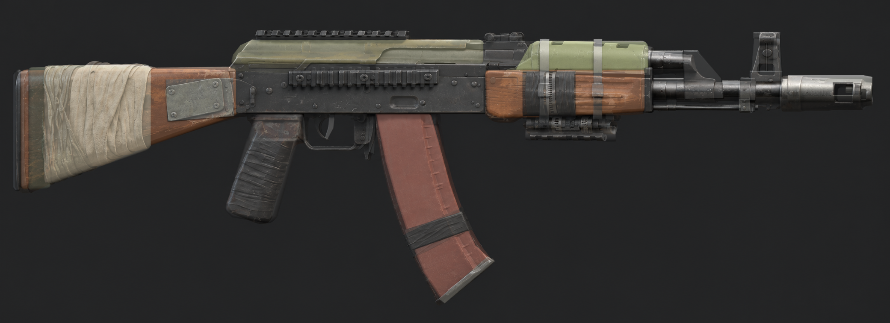

# KS-74 «Зарница» — scavenger-pattern blockout

The base 3D model for the LAST LIGHT: Echoes of Tomorrow signature rifle. It has the correct size, proportions and part breakdown, uses flat placeholder materials and has no sculpted detail. It's meant as the starting point for the high-poly/low-poly pass in Blender and for early Unreal Engine 5.8 tests (first-person framing, hand placement, attachments, reload animation).


*Blockout side view (mirrored) blended 50/50 over the approved reference `concept/ref_side_a.png`.*

## Files

| Path | What |
|---|---|
| `concept/KS74_concept_sheet.png` | Final concept sheet (callouts, decals, attachment points A–G) |
| `concept/ref_*.png` | Approved AI reference renders (hero, both sides, optic configs) |
| `blockout/build_blockout.py` | **Source of truth.** Generates everything below |
| `blockout/KS74_Zarnitsa_Blockout.blend` | Editable Blender file: live bevel modifiers, quads/ngons, parented hierarchy |
| `blockout/KS74_Zarnitsa_Blockout.fbx` | Unreal import: triangulated, modifiers applied, smoothing groups, `SOCKET_` empties |
| `blockout/KS74_Zarnitsa_Blockout.glb` | Quick viewing in any glTF viewer |
| `blockout/KS74_Zarnitsa_parts.json` | Every part's size, pivot, material and parent, plus socket positions |
| `blockout/render_previews.py` | Cycles preview renders → `blockout/previews/` |
| `blockout/verify_fbx.py` | Re-imports the FBX and prints mesh count, size, sockets and materials |

## Regenerate

Blender 5.0+ (also works with the `bpy` 5.0 pip module on Python 3.11):

```bash
cd art/weapons/ks74_zarnitsa/blockout
blender -b -P build_blockout.py      # .blend / .fbx / .glb / parts.json
blender -b -P render_previews.py     # previews (~2.5 min on 2 CPU cores)
blender -b -P verify_fbx.py          # sanity check of the FBX
```

Every side-profile coordinate in the script is a pixel position measured on `concept/ref_side_a.png` (scale: 2002 px = 943 mm, the AK-74 overall length). Change a number and re-run to adjust a shape. Once you start hand-modeling in the `.blend`, treat that file as the source and stop re-running the script, because it would overwrite your edits.

## Conventions

- **Size:** 947 × 66 × 301 mm (length × width × height). About 18k triangles with bevels.
- **Axes:** +X = muzzle (Unreal forward), +Z = up, +Y = the rifle's **left** side (side rail, stock plate). The right side (−Y) carries the selector, charging handle and ejection port, as on a real AK. The AI reference renders show the rifle mirrored. The model follows the real layout.
- **Units:** Blender scene in metres (1 m = 100 Unreal units). The FBX exports with unit scale applied.
- **Origin:** `KS74_Root` sits on the bore axis directly above the pistol grip.
- **Pivots:** placed for animation and swapping. Magazine = front locking lug (AK rock-in reload), trigger = trigger pin, selector = rear axle, bolt carrier = charging-handle knob (slides −X), muzzle brake = thread shoulder, stock = rear trunnion, grip = grip top.
- **Hierarchy:** dressing parts are children of the part they belong to (tape → grip, wrap/cord/plate/buttplate → stock, floorplate/tape → magazine, clamps/flashlight → clamp rail, top rail → dust cover, gas tube → upper handguard), so swapping a part moves its dressing with it.

## Sockets (Unreal)

The empties named `SOCKET_<Name>` are children of `KS74_Receiver`. Unreal's FBX static-mesh importer turns them into mesh sockets.

| Socket | Use | Sheet tag |
|---|---|---|
| `Optic_Top` | Red dot / holo / thermal on the welded rail | A |
| `Optic_Side` | Side-mount magnified scope | B |
| `Muzzle` | Brake / suppressor swap (thread shoulder) | C |
| `MuzzleFlash` | Muzzle-flash FX at the brake face | — |
| `Underbarrel` | Foregrip on the clamp rail (points down) | D |
| `Tactical_L` | Light / laser on the left of the handguard | — |
| `Magazine` | Magazine attach (front lug) | E |
| `Stock` | Stock swap | F |
| `Grip` | Grip swap / right-hand IK | G |
| `Hand_L` | Support-hand IK under the handguard | — |
| `Eject` | Shell ejection FX (right side, points −Y) | — |

## Unreal Engine 5.8 import

1. Import `KS74_Zarnitsa_Blockout.fbx` as a **Static Mesh** with *Combine Meshes* **on** for one test mesh with sockets, or **off** for one mesh per part (modular testing). Leave *Import Uniform Scale* at 1.0.
2. Keep *Import Materials* on. Each `M_KS74_*` slot comes in as a plain colour material.
3. Gameplay-wise this is a static mesh. For a reload or bolt animation, rig it as a skeletal mesh. The part pivots above are already where the bones should go.

*I haven't tested this inside Unreal itself. It's checked by re-importing the FBX in Blender (`verify_fbx.py`): 33 meshes, fully triangulated, 11 sockets, correct size.*

## Parts

| Part | Parent | Material | Size mm (L × W × H) | Note |
|---|---|---|---|---|
| `KS74_Receiver` | Root | Steel | 280.7 × 32.3 × 54.6 | Stamped receiver, rivets both sides, ejection port right |
| `KS74_DustCover` | Root | PaintOD | 278.3 × 32.0 × 27.8 | Owner I green repaint |
| `KS74_DustCover_TopRail` | DustCover | Steel | 168.6 × 21.2 × 12.7 | Welded Picatinny, weld beads |
| `KS74_RearSight` | Root | Steel | 54.6 × 26.0 × 34.4 | AK-74 leaf sight |
| `KS74_SideRail` | Root | Steel | 163.9 × 8.5 × 21.7 | Bolted left-side Picatinny |
| `KS74_BoltCarrier` | Root | SteelWorn | 102.6 × 38.0 × 17.3 | Carrier + charging handle |
| `KS74_Selector` | Root | SteelBare | 131.8 × 2.0 × 25.4 | Right side |
| `KS74_TriggerGuard` / `KS74_Trigger` / `KS74_MagCatch` | Root | Steel | — | Fire-control group |
| `KS74_Grip` (+ `_Tape`) | Root | PolymerBlack / Tape | 84.8 × 30.0 × 119.8 | Owner IV tape wrap |
| `KS74_Stock` (+ `_Buttplate`, `_Wrap`, `_Cord`, `_Plate`) | Root | Wood / Steel / Cloth / Cord / SteelWorn | 240.2 × 41.8 × 135.2 | Walnut stock, canvas rag, cord, riveted plate |
| `KS74_Magazine` (+ `_Floorplate`, `_Tape`) | Root | PolymerMag / SteelWorn / Tape | 125.0 × 26.0 × 206.4 | 30-round 5.45 |
| `KS74_Handguard_Lower` (+ `_Tape`) | Root | Wood / Tape | 181.7 × 50.0 × 52.8 | Cracked walnut, taped |
| `KS74_Handguard_Upper` (+ `KS74_GasTube`) | Root | PolymerOD / Steel | 145.8 × 44.0 × 33.0 | Olive replacement cover |
| `KS74_Handguard_Retainer` | Root | Steel | 10.4 × 52.0 × 49.9 | |
| `KS74_Barrel` | Root | Steel | 330.7 × 24.0 × 24.0 | Visible length |
| `KS74_GasBlock` / `KS74_FrontSight` / `KS74_CleaningRod` | Root | Steel | — | |
| `KS74_MuzzleBrake` | Root | SteelWorn | 99.9 × 30.0 × 30.0 | Two windows + bore cut |
| `KS74_ClampRail` (+ `KS74_HoseClamps`, `KS74_Flashlight`) | Root | Steel / SteelBare / PolymerBlack | 82.9 × 21.2 × 15.1 | Hose-clamped accessory rail |

Full numbers, including pivots, are in `KS74_Zarnitsa_parts.json`.

## Not in the blockout yet (next passes)

- **Shape refinement:** curved pistol-grip ergonomics, the stock's real cross-section taper, handguard vent slots, dust-cover ribs, the AK magazine's rib pattern.
- **Soft goods:** tape and cloth are simple shells. Sculpt the folds, lifted tape ends and cord loops in the high-poly pass.
- **Decals:** `КС-74`, `ЗН 4417 08`, `2031`, `АВ / ОД`, `№07`, `300 ↑2`, `ВОРОН` (positions are on the concept sheet).
- **Production:** high-poly → low-poly bake, LODs, and consolidating the 11 colour slots into about 4 texture sets (Receiver/Barrel, Furniture, Magazine, Wraps).
- **Attachments:** the 4× scope and thermal sight from `concept/ref_optic_configs.png` aren't modeled. They mount on `Optic_Side` and `Optic_Top`.
